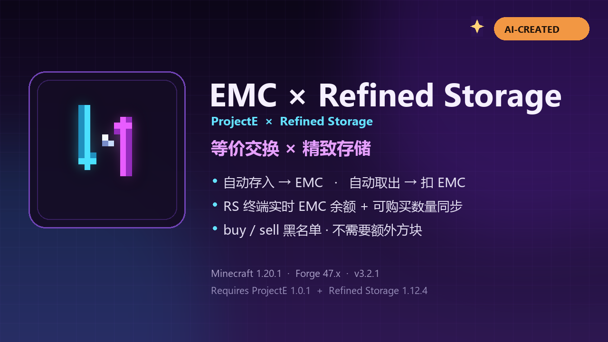

# EMC × Refined Storage

> **AI 创作声明 / AI-Created**
>
> 本模组的代码、功能设计、文档与封面均由 **AI 创作并实现**。
> This mod, including its code, feature design, documentation and cover art, was **created and implemented by AI**.

一个面向 **Minecraft 1.20.1 / Forge** 的 **等价交换（ProjectE）× 精致存储（Refined Storage）** 联动模组。

- Mod ID：`emc_rs`
- 当前版本：`3.2.1`
- 前置：ProjectE `1.20.1-PE1.0.1`、Refined Storage `1.12.4`、Forge `47.x`
- 许可证：MIT
- 下载：[GitHub Releases](https://github.com/AuZn111/emc-rs/releases)
- 单人使用优化；无需额外方块。



---

## 功能

### 1. 存入网络 → 自动转 EMC

- RS 网络中任何插入路径（终端 Shift 点击、导入器、接口等）都会优先经过自动回收存储。
- 有 ProjectE 回收价值的物品会立即转化为 **网络主人** 的 EMC。
- 没有 EMC 价值、回收价值为 0、或位于 **sell 黑名单** 的物品会正常进入 RS 存储。
- 第一次回收某物品会自动学习它。

> ⚠️ 默认 `sell` 黑名单为空，因此**任何有 EMC 价值的物品一进网络就会变成 EMC**。
> 想正常存储的机器、存储盘、工具等，请先加入 `sell` 黑名单。

### 2. 从终端取出 → 自动扣 EMC

- RS 终端里显示主人已学习、有 EMC 价值、且不在 `buy` 黑名单中的物品。
- 取出时先消耗网络真实库存；真实库存不足才按 EMC 价值扣主人 EMC。
- `buy` 黑名单里的物品不会出现在虚拟 EMC 商店，但真实库存仍可正常取出。

### 3. EMC 余额与数量同步

- RS 终端物品栏上方右侧显示金色 **EMC 余额**。
- 虚拟可购买数量每约 1 秒按实时 EMC **增量同步**。
- 数量通过 RS 原生 `GridItemDeltaMessage` 更新，不重建缓存、不改变条目 UUID，因此数量准确的同时也不会出现“点不出来”。

### 4. EMC 侧边按钮

打开方块 RS 终端后，右侧有 EMC 控制按钮：

| 操作 | 效果 |
| --- | --- |
| 普通点击 | 查看状态；首次点击会绑定当前玩家为网络 EMC 主人 |
| Shift + 点击 | 重新绑定 EMC 主人（当前主人或 OP） |
| Ctrl + 点击 | 按终端右侧 4 个过滤槽的物品，回收网络真实库存为 EMC（跳过 sell 黑名单） |

---

## 安装

1. 安装 Minecraft 1.20.1 + Forge 47.x。
2. 将以下文件放入 `mods/`：
   - `emc_rs-3.2.1.jar`
   - `refinedstorage-1.12.4.jar`
   - `ProjectE-1.20.1-PE1.0.1.jar`
3. 启动游戏，不需要合成任何新方块。

---

## 使用流程（单人）

1. 正常放置 RS 控制器，接上 RS 终端和存储。
2. 控制器由你放置时，会自动成为该网络的 EMC 主人；如果是命令/结构放置或没有记录，打开方块 RS 终端点一次 EMC 按钮绑定。
3. 打开 RS 终端：已学习物品直接显示；取出时真实库存优先，不足扣 EMC。
4. 往网络放物品：有 EMC 价值且不在 `sell` 黑名单里的会自动变成 EMC。
5. 批量回收已有库存：把物品放入终端右侧过滤槽，Ctrl 点击 EMC 按钮。

---

## 黑名单配置

文件：**`config/emc_rs-common.toml`**（首次启动生成）

```toml
[blacklist]
    buy = []
    sell = []
```

条目支持物品注册名或 `#tag`：

```toml
[blacklist]
buy = [
    "minecraft:bedrock",
    "#minecraft:logs"
]
sell = [
    "refinedstorage:1k_storage_disk",
    "refinedstorage:4k_storage_disk",
    "refinedstorage:16k_storage_disk",
    "refinedstorage:64k_storage_disk",
    "minecraft:netherite_pickaxe"
]
```

- `buy`：不能用 EMC 购买（不进入虚拟商店）。
- `sell`：插入网络时不会被自动转成 EMC，正常存储。
- 只支持物品 ID / 标签，不支持按 NBT 精确匹配。
- 修改后需要重启游戏/服务器生效。

---

## 重要说明

- **AI 创作**：本模组代码、设计、文档、封面由 AI 创作/实现。
- **单人使用优化**：当前重点是单人流程；多人共享/主人离线逻辑保留但不是优化重点。
- **网络级共享**：一个网络只有一个 EMC 主人（控制器放置者/绑定者）。
- **主人必须在线**：主人离线时终端不显示可购买物品，也不能自动回收。
- **只使用玩家面板上的基础 EMC**：转化桌输入槽或 Klein Star 里的 EMC 不会被读取。
- **自动回收会拦截网络插入**：请先把不想被回收的物品加入 `sell` 黑名单。
- **EMC 按钮只加在方块 RS 终端上**；便携/无线终端仍能看到虚拟物品并按 EMC 取出，但没有按钮。
- 只处理物品，不处理流体。
- 只适用于 1.20.1 + RS 1.12.x + ProjectE 1.0.x；不兼容 RS 2.x / 1.21。

---

## 构建

需要 JDK 17。

```bash
./gradlew build
# Windows:
gradlew.bat build
```

开发依赖不随仓库分发，请把以下文件放入 `libs/`：

- `refinedstorage-1.12.4.jar`
- `projecte-1.20.1-PE1.0.1.jar`

详见 [libs/README.md](libs/README.md)。

产物：`build/libs/emc_rs-3.2.1.jar`。

---

## 实现简述

- Mixin `ItemStorageCacheMixin`：每次 RS 重建物品缓存时注入自动买入/自动卖出存储。
- Mixin `RootNetworkNodeMixin`：记录控制器放置者为网络 EMC 主人。
- Mixin `NetworkMixin`：每约 1 秒按实时 EMC / 知识增量更新缓存数量（不重建缓存）。
- `NetworkEmcSellStorage`：INSERT-only、最高优先级，自动把有 EMC 价值的物品转成 EMC。
- `NetworkEmcBuyStorage`：EXTRACT-only、最低优先级，真实库存优先，不足扣 EMC。
- `EmcConfig` / `EmcBlacklist`：`config/emc_rs-common.toml` 的 buy/sell 黑名单。
- 所有 EMC 读写使用 ProjectE 官方 `IKnowledgeProvider` / `IEMCProxy` API。

## 致谢与声明

- 本项目是 **ProjectE** 与 **Refined Storage** 的第三方联动，不隶属于这两个项目。
- 前置模组归各自作者所有；本仓库不包含它们的二进制文件。
- 本模组为 **AI 创作**，使用 MIT 许可证。

## License

MIT
